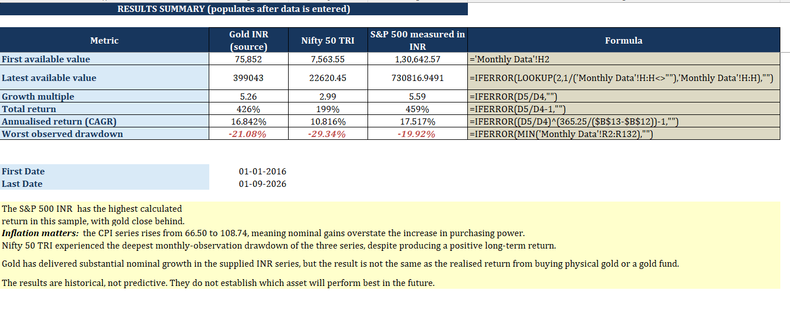
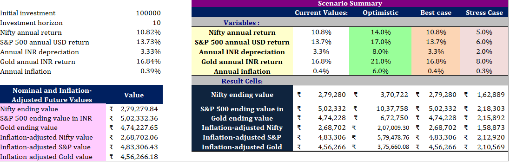

# The ₹100 Dollar Question
### Does a Falling Rupee Change Which Investments Build Wealth?

**Investment Research | Excel Analytics | January 2016 – September 2026**

Can currency depreciation change how an Indian investor experiences investment returns?

This project compares Indian equities, US equities translated into INR, gold and Indian inflation to explore how returns, currency movements, drawdowns and purchasing power influence the interpretation of wealth creation.

---

## 📊 Project Overview

The project uses a monthly historical dataset to examine three investment series:

- **Nifty 50 TRI** — Indian equity performance, including reinvested dividends.
- **S&P 500 translated into INR** — US equity performance viewed through an Indian currency lens.
- **Gold priced in INR** — historical gold performance in rupees.

USD/INR exchange rates and India's Consumer Price Index (CPI) provide additional context for currency translation and inflation analysis.

## 📁 Project Files

| Resource | Description |
|---|---|
| [📈 Excel Research Workbook](./Rupee_Wealth_Research_Workbook.xlsx) | Historical data, calculations and investment analysis |
| [📄 Detailed Research Report](./The_100_Dollar_Question_Detailed_Research_Report.docx) | Research objectives, methodology, findings and limitations |
| [🖼️ Project Visual 1](./7.png) | Supporting project visual |
| [🖼️ Project Visual 2](./9.png) | Supporting project visual |

**Start here:** Review the research summary below, then open the Excel workbook to explore the analysis.

## 🖼️ Project Gallery

### Research Visual 1

### Research Visual 2

## 🔍 Research Objectives

- Compare historical growth and compound annual growth rates (CAGR).
- Examine the effect of USD/INR movements on INR-denominated US equity values.
- Compare historical peak-to-trough drawdowns.
- Distinguish nominal investment growth from inflation-adjusted purchasing power.
- Explore alternative assumptions through Excel scenario analysis.
- Build a transparent, reproducible finance analytics project.

## 📈 Preliminary Historical Findings

The current workbook reports the following annualised returns for the selected period:

| Investment series | Reported CAGR |
|---|---:|
| S&P 500 translated into INR* | 17.52% |
| Gold priced in INR | 16.84% |
| Nifty 50 TRI | 10.82% |

The workbook also reports different worst observed monthly drawdowns across the three series.

These are **preliminary workbook results**, not independently audited findings. Verify the source data, S&P 500 index variant, date alignment, currency conversion and CPI calculations before treating these figures as final.

\*The S&P 500 INR series is a constructed proxy, not the realised return of a specific investment product.

## 🧮 Methodology

The workbook examines:

- **Cumulative return:** Change between the first and last observations.
- **CAGR:** Annualised compounded growth over the study period.
- **Drawdown:** Decline from a previous observed peak.
- **Currency translation:** Converts the selected US equity series into INR using the chosen USD/INR observations.
- **Inflation adjustment:** Uses CPI to assess changes in purchasing power.
- **Scenario analysis:** Illustrates how different return, currency and inflation assumptions can affect hypothetical outcomes.

The study uses monthly observations from January 2016 to September 2026. Source-series consistency and the final observation dates must be verified before publication.

## 🛠️ Tools and Skills

- Microsoft Excel
- Financial modelling and spreadsheet formulas
- Investment return and drawdown analysis
- Currency and inflation analysis
- Historical time-series analysis
- Scenario and sensitivity analysis
- Financial research and data interpretation

## 🌐 Data Sources

- [Nifty Indices](https://www.niftyindices.com/reports)
- [S&P Dow Jones Indices — S&P 500](https://www.spglobal.com/spdji/en/indices/equity/sp-500/)
- [FRED — USD/INR (EXINUS)](https://fred.stlouisfed.org/series/EXINUS)
- [World Gold Council — Gold Prices](https://www.gold.org/goldhub/data/gold-prices)
- [MoSPI — CPI Data Catalogue](https://esankhyiki.mospi.gov.in/catalogue-main/catalogue?product=CPI)

## ⚠️ Limitations

- The S&P 500 index variant and dividend treatment must be verified.
- Monthly-average exchange rates may not represent month-end conversion rates.
- CPI series, base and observation dates must be consistent.
- Taxes, transaction costs, fund expenses, tracking error and product-specific costs are not fully included.
- Monthly data can miss intramonth market losses.
- Scenario outputs are hypothetical illustrations, not forecasts.

## 💡 Key Takeaway

Investment performance cannot always be understood from nominal returns alone. For an Indian investor, currency movements and inflation can materially change the interpretation of wealth creation.

The goal of this project is not to declare one asset universally superior, but to demonstrate how financial data, transparent assumptions and multiple performance measures can improve investment analysis.

## 👤 About This Project

An independent finance research and analytics project exploring financial markets, investment returns, currency movements and data-driven decision-making.

**Disclaimer:** This project is for educational and research purposes only. It is not investment advice. Past performance does not guarantee future results.
